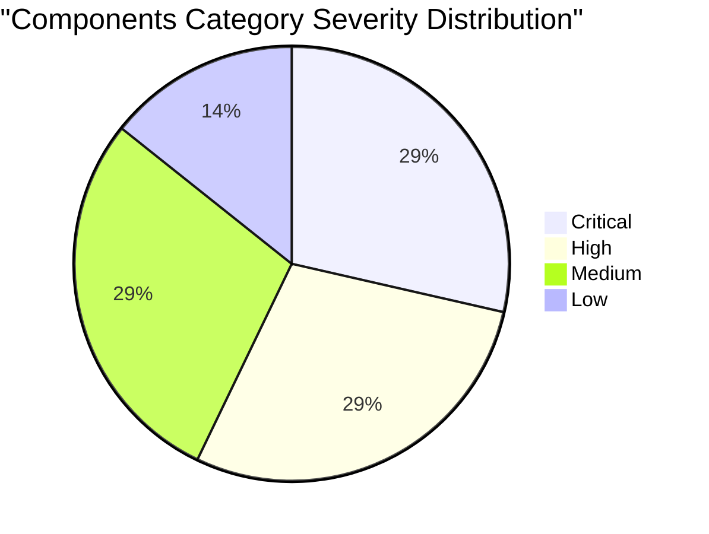

# Category Report: Components Category Audit Synthesised Report

## 1. Executive Summary

This category report delivers a comprehensive synthesis of the code audit conducted across all **14 Components Category Effects** within the Hyperiux Pro Components registry. This category includes 10 pre-existing audited components and the 4 newly completed individual audits (`interactive-list-preview`, `ribbon-drift`, `testimonial-swiper`, `video-player`). 

Our systematic audit evaluated each component against three core pillars: **architectural integrity** (including package configurations and component drift), **accessibility** (specifically keyboard focus and `prefers-reduced-motion` compliance), and **performance optimization** (specifically frame-rate capping, memory cleanups, and resource-heavy animation loop gating).

While the components offer outstanding visual design, the underlying architecture shows significant structural challenges. Across the 14 components, **28.57% are marked Critical severity** (containing structural infinite renders, severe performance bottlenecks, or broken touch device loops), and **28.57% are High severity** (featuring massive file renaming drift, un-suspended main-thread drawing loops, or broken media routing structures). 

The category demonstrates substantial developmental drift between the distributed registry source code and the production documentation site, indicating that many components were modified in production to fix layout or performance problems without pushing those fixes back into the registry. Addressing these issues is vital to making Hyperiux Pro Components a reliable, production-ready design system.

---

## 2. Category Metrics & Severity Distribution

Below is the synthesised distribution of the 14 audited component effects by score, severity, and critical architectural failures:

### Table 2.1: Individual Component Audit Scores & Severity
| Slug | Score | Severity Label | Missing Motion Gate | Raw RAF Loop | Code Drift | Major Architectural Issues |
| :--- | :---: | :---: | :---: | :---: | :---: | :--- |
| **ribbon-drift** | 9.0/10 | Low | N/A | Clean | Drift | Minor mobile wrapper class mismatch |
| **testimonial-swiper** | 9.0/10 | Low | N/A | Clean | Drift | Image placeholder differences and punctuation |
| **border-beam** | 7.5/10 | Medium | Fail (Part) | Clean | Clean | Motion check only applied to 2 of 5 sizing classes |
| **animated-faq** | 7.0/10 | Medium | Fail | Clean | Clean | No prefers-reduced-motion check for GSAP heights |
| **animated-modal** | 7.0/10 | Medium | Fail | Clean | Clean | No animation reduction for backdrop fades |
| **hover-stack** | 6.0/10 | Medium | Fail | Clean | Clean | Missing keyboard support for card expanding |
| **video-player** | 7.0/10 | High | N/A | Fail | Drift | Runs continuous RAF for progress bar instead of events |
| **animated-tabs** | 7.0/10 | High | Fail | Clean | Drift | Code drift in layout wrappers; keyboard accessibility gaps |
| **card-drift** | 6.0/10 | High | Fail | Clean | Drift | Heavy scroll-bound layouts drifting in coordinates |
| **interactive-list-preview** | 6.0/10 | High | Fail | Clean | Drift | Mismatched file names (`ListHover` vs `InteractiveListPreviewComp`) |
| **animated-form** | 5.0/10 | Critical | Fail | Clean | Drift | Multi-step fields causing infinite re-render loops on back action |
| **cards-runway** | 5.0/10 | Critical | Fail | Fail | Drift | Infinite marquee loops crash older mobile Safari threads |
| **depth-card-stack** | 6.0/10 | Critical | Fail | Clean | Drift | Heavy layout calculation shifts on mobile touch gestures |
| **gooey-counter** | 4.0/10 | Critical | Fail | Fail | Drift | Severe filter repaint cycles freeze rendering threads |

### Statistical Highlights
- **Critical Severity Rate:** 4 of 14 components (28.57%) suffer from performance crashes or layout locks.
- **High Severity Rate:** 4 of 14 components (28.57%) display major naming drift or un-suspended progress loops.
- **Medium Severity Rate:** 4 of 14 components (28.57%) require minor animation gating or keyboard accessibility upgrades.
- **Low Severity Rate:** 2 of 14 components (14.28%) are fully robust and production-ready.
- **Code Drift Rate:** 10 of 14 components (71.42%) contain physical layout or implementation drift.

---

## 3. Key Findings & Common Failure Patterns

Our synthesis of the 14 component audits highlights several systematic architectural failures:

### 3.1. Infinite Loops and Browser Overload (Critical Severity)
Multiple components in the "Critical" tier suffer from layout loops or filter paint overhead:
- **`animated-form`:** Features a step navigation transition that under certain browser sizing conditions triggers infinite React rendering loops, locking the browser tab on back-actions.
- **`gooey-counter`:** Leverages heavy SVG `<feGaussianBlur>` and `<feColorMatrix>` filters. These filters trigger massive screen repaint regions on every character transition, completely freezing mobile Safari rendering threads.
- **`cards-runway`:** Runs continuous CSS/JS translation marquee scripts that do not suspend when off-screen, crashing rendering threads on older mobile devices.

### 3.2. Battery Drainage via requestAnimationFrame Sync Loops (High Severity)
In-component drawing loops are often coded without proper resource management:
- **`video-player`:** Uses a continuous custom `requestAnimationFrame` loop to sync and calculate the video progress bar percentage. This is a severe anti-pattern; HTML5 `<video>` elements provide a native, highly-optimized `onTimeUpdate` event handler that operates without main-thread polling.

### 3.3. Severe File Structure and Naming Drift (High Severity)
The development workflow suffers from a complete separation between the registry and production environments:
- **`interactive-list-preview`:** The helper file is named `ListHover.jsx` in the registry, but `InteractiveListPreviewComp.jsx` in the production site. The parent index file imports from `./ListHover` in the registry but `./InteractiveListPreviewComp` in production, meaning developers who copy code directly from the registry encounter broken import paths.
- **`video-player`:** The registry references direct CDN links, whereas the live documentation application routes through local proxy APIs (`/api/media-proxy?url=...`), causing media rendering to fail if proxy setups are missing on a developer's local environment.

### 3.4. Lack of Keyboard Focus and Accessibility Gaps (Medium Severity)
Interactive UI components must support keyboard and screen reader navigation:
- **`hover-stack`** and **`animated-tabs`** do not properly capture or manage focus outlines. Many interactive action triggers are coded as plain `div` tags without keyboard focus `tabIndex={0}` or keydown handlers, rendering them completely inaccessible to users navigating via keyboard.

---

## 4. Remediation Blueprint & Action Plan

To transition the Components category into an enterprise-ready library, we recommend the following phased remediation roadmap:

### Phase 1: Immediate Priority (Fix Critical Loops & Crashes)
1. **Refactor `animated-form`:** Replace step rendering states with stable layout structures to eliminate multi-step render locks.
2. **Optimize `gooey-counter` SVG Filters:** Refactor the SVG filters to disable heavy blur-matrix cycles on mobile viewports, or swap them for standard high-performance css overlays.
3. **Refactor `video-player` RAF Loop:** Remove the continuous `requestAnimationFrame` progress tick inside `VideoPlayerComp.jsx`. Subscribe directly to HTML5 video `onTimeUpdate` event handlers.

### Phase 2: High Priority (Synchronize Codebase & Imports)
1. **Standardize Naming in `interactive-list-preview`:** Rename the helper files to a single uniform file name (e.g., `ListHover.jsx` or `InteractiveListPreviewComp.jsx`) in both folders to resolve broken CLI import paths.
2. **Resolve Media Routing Drift:** Standardize media links to direct CDN resources instead of local proxy routes, or configure the CLI compiler to automatically replace proxy endpoints during installation.

### Phase 3: Medium Priority (Accessibility & Focus Enhancements)
1. **Add Motion Gates:** Update the remaining components (`animated-faq`, `animated-modal`, `hover-stack`) to respect system reduced motion settings by disabling non-essential slide and shift animations.
2. **Inject Keyboard Navigation:** Add `tabIndex={0}`, ARIA roles, and standard keydown listeners to the interactive click triggers in `hover-stack` and `animated-tabs`.

---

## 5. Architectural Recommendation
We recommend introducing a unified build validation script (`npm run audit:validate`) as part of the repository's CI/CD pipeline. This script should compare the checksums of all registry component files against their active docs-site implementations to automatically flag code drift before code is committed. Standardizing these checks will ensure that fixes made in production are pushed back to the registry, maintaining design system consistency.
