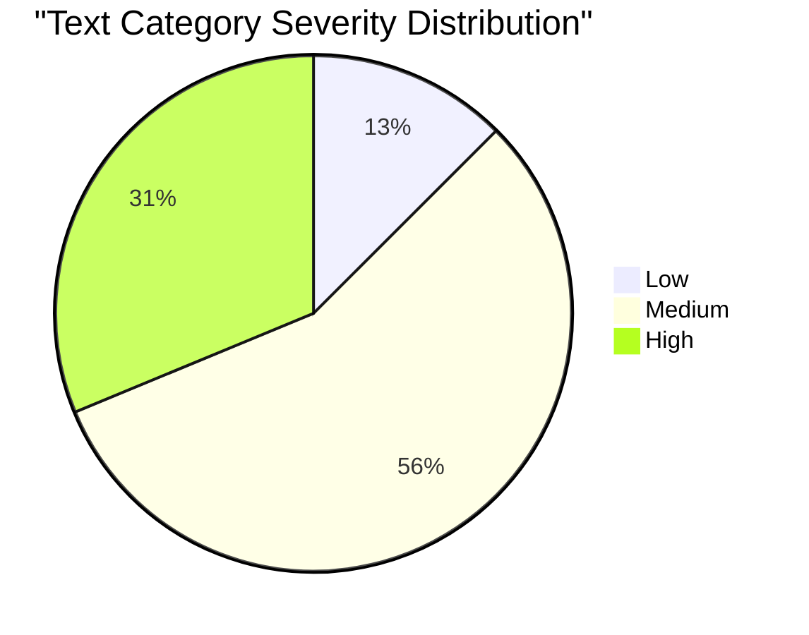
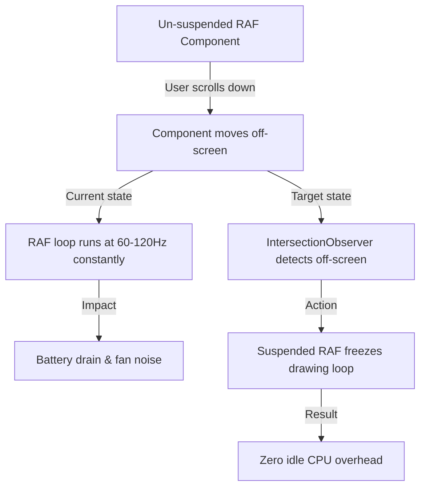

# Category Report: Text Effects Audit Synthesised Report

## 1. Executive Summary

This category report presents a comprehensive, evidence-based synthesis of the code audit conducted across all **16 Text Effects** within the Hyperiux Pro Components registry. The text category is critical to the Hyperiux brand, delivering immersive, fluid, and futuristic typography animations that create a premium first impression. 

Our systematic audit evaluated each component against three core pillars: **architectural integrity** (including code drift and metadata correctness), **accessibility** (specifically `prefers-reduced-motion` compliance), and **performance optimization** (with a focus on frame-rate capping and background execution gating).

While the visual aesthetics of the text effects are undeniably exceptional, the underlying codebase reveals systemic weaknesses. **68.75% of text components fail to support user-level reduced motion preferences**, and **31.25% run continuous, raw, un-suspended animation loops** that drain processing cycles in background tabs. Furthermore, **50% of the category exhibits structural file drift** between the distributed registry source code and the production documentation site. Addressing these issues is paramount to elevating Hyperiux from an aesthetic showpiece to a production-ready enterprise-grade design system.

---

## 2. Category Metrics & Severity Distribution

Below is the distribution of the 16 audited text effects by score, severity, and critical architectural failures:

### Table 2.1: Individual Text Component Audit Scores
| Slug | Category | Score | Severity Label | Missing Motion Gate | Raw RAF Loop | Code Drift |
| :--- | :---: | :---: | :---: | :---: | :---: | :---: |
| **mask-text-reveal** | Text | 10/10 | Low | Clean | Clean | Clean |
| **number-counter** | Text | 9/10 | Low | N/A | Clean | Drift |
| **slide-text-reveal** | Text | 8/10 | Medium | Fail | Clean | Clean |
| **perspective-text-reveal** | Text | 8/10 | Medium | Fail | Clean | Clean |
| **rectangular-text-reveal** | Text | 8/10 | Medium | Fail | Clean | Clean |
| **overflow-stagger-text** | Text | 8/10 | Medium | Fail | Clean | Clean |
| **glitchy-text** | Text | 8/10 | Medium | Fail | Clean | Clean |
| **blur-text** | Text | 8/10 | Medium | Fail | Clean | Drift |
| **overflow-text-reveal** | Text | 8/10 | Medium | Fail | Clean | Drift |
| **text-fill-animation** | Text | 8/10 | Medium | Fail | Clean | Drift |
| **text-stream** | Text | 7/10 | Medium | Fail | Clean | Drift |
| **text-cloning** | Text | 7/10 | High | N/A | Fail | Clean |
| **circle-text-reveal** | Text | 6/10 | High | Clean | Fail | Drift |
| **scramble-text** | Text | 6/10 | High | Fail | Fail | Clean |
| **spotlight-text** | Text | 6/10 | High | Clean | Fail | Drift |
| **text-hover** | Text | 6/10 | High | Fail | Fail | Drift |

### Statistical Highlights
- **Perfect Implementations (10/10):** 1 component (6.25%) — `mask-text-reveal`.
- **Low Severity (Score >= 9.0):** 2 components (12.5%).
- **Medium Severity (Score 7.0 - 8.5):** 9 components (56.25%).
- **High Severity (Score < 7.0):** 5 components (31.25%).
- **Prefers-Reduced-Motion Failure Rate:** 11 of 16 components (68.75%) run animation sequences unconditionally.
- **Un-suspended RAF Loops:** 5 of 16 components (31.25%) execute continuous polling thread animations without suspension.
- **Code Drift Rate:** 8 of 16 components (50.0%) exhibit physical code or class mismatches.

---

## 3. Systematic Architecture & Code Quality Patterns

The audit revealed three pervasive, category-wide anti-patterns that degrade the maintainability, performance, and accessibility of the design system.

### 3.1. Systemic Prefers-Reduced-Motion Blind Spot
A design system offering premium motion-driven experiences must treat accessibility as a core constraint, not an afterthought. Of the 16 text components, **11 animate unconditionally**. 
Continuous flickering (e.g., `glitchy-text`), fast scrolling accelerations (e.g., `text-stream`), 3D flipping (e.g., `perspective-text-reveal`), and large-scale blurs (e.g., `blur-text`) are played automatically without assessing system motion preferences. This triggers major accessibility hurdles for motion-sensitive users. Only `mask-text-reveal` integrates a clean media query handler, serving as a template for other effects.

### 3.2. Battery Drainage via Raw, Un-suspended `requestAnimationFrame` Loops
WebGL and canvas effects must manage their CPU/GPU footprint responsibly. However, 5 components (`circle-text-reveal`, `scramble-text`, `spotlight-text`, `text-cloning`, and `text-hover`) implement raw, main-thread `requestAnimationFrame` loops. 
None of these loops are integrated with the shared `createSuspendedRaf` or `createVisibilityGate` utilities, nor do they track element intersection. As a result, when these components are rendered, they continue drawing and calculating mouse coordinates at display refresh rate even if the component is entirely offscreen or located in a background browser tab.

### 3.3. Dual-Branch Development & Component Drift
The audit discovered that **50% of the text components contain file drift** between `/registry/effects/text/` and `/apps/docs/src/components/`. 
The types of drift vary in severity:
1. **Import and Tooling Drift:** `blur-text` imports from `framer-motion` in the registry, but `motion/react` in docs.
2. **Prop Interface Drift:** `blur-text` hardcodes `once: true` in the registry, while the docs version supports a customizable `once` prop.
3. **Responsive Breakpoint Drift:** `spotlight-text` uses different media queries (`max-xl` in registry vs `max-md` in docs), changing the hidden threshold of the spotlight overlay on tablets.
4. **HTML Semantic Drift:** `text-fill-animation` uses `<h2>` headings in the registry, but `<h1>` in docs, causing unexpected SEO outlines when components are installed via CLI.

---

## 4. Remediation Blueprint & Action Plan

To transition the Text category into an enterprise-grade library, we recommend the following phased remediation roadmap:

### Phase 1: High Priority (Standardize Animation Frames)
- **Action:** Refactor the 5 components utilizing raw `requestAnimationFrame` loops (`circle-text-reveal`, `scramble-text`, `spotlight-text`, `text-cloning`, `text-hover`) to use centralized visibility-gated animation loops.
- **Reference Template:** Use standard `IntersectionObserver` handlers to freeze animations when components exit the viewport.

### Phase 2: Medium Priority (Accessibility Harmonization)
- **Action:** Introduce prefers-reduced-motion checkers to the 11 failing effects.
- **Remediation Pattern:**
  - For **Framer Motion** components, inject the `useReducedMotion` hook to simplify transitions.
  - For **GSAP** components, encapsulate timelines inside `gsap.matchMedia("(prefers-reduced-motion: reduce)")` blocks to swap sweeping translations for instant fades.

### Phase 3: Low Priority (Codebase Sync)
- **Action:** Execute a complete synchronization of the 8 drifted components, aligning default props, media breakpoints, and HTML heading structures with the live documentation configurations. Remove debug statements such as commented out ScrollTrigger markers from the registry folders.

---

## 5. Architectural Recommendation
A single shared hook, `useAnimationGate`, should be defined in `/registry/effects/_shared/hooks/` to solve the raw RAF and reduced motion problems across the entire design system. This hook should detect both page visibility and viewport intersection to automatically pause registered animation frames, while returning a standard boolean flag indicating whether animations should be simplified for accessibility. Doing so will prevent future developers from introducing leaky raw loop variants, ensuring sustainable scalability.
